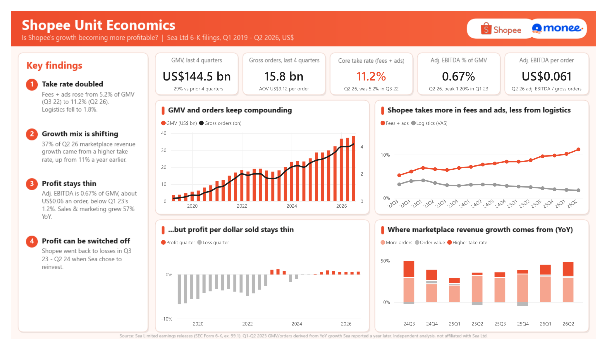
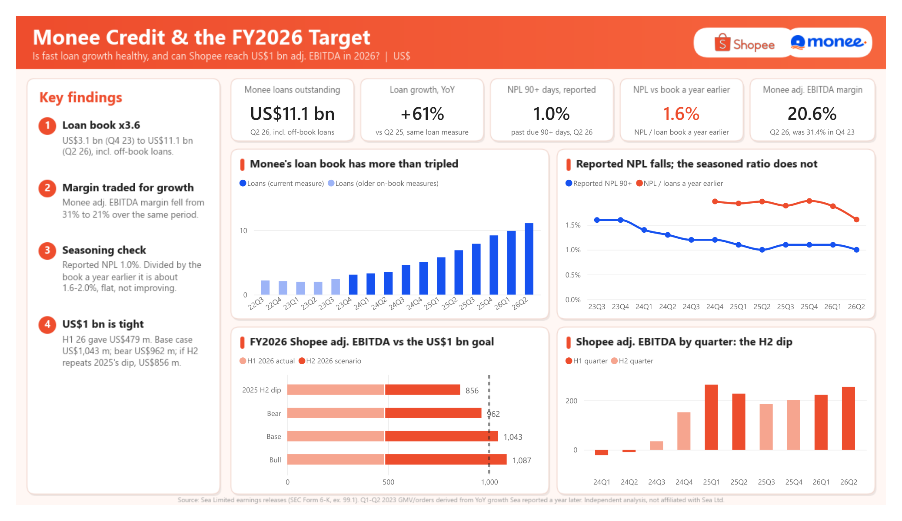

# Shopee & Monee Unit Economics (Sea Ltd, Q1 2019 – Q2 2026)

This project asks three questions using Sea Limited's own quarterly earnings releases:
- Is Shopee's growth becoming more profitable?
- Is Monee's fast loan growth staying healthy?
- Before Sea reports the second half, how likely is a US$1 billion Shopee adjusted EBITDA in FY2026? This is a nowcast made on 15 Oct 2026 from H1 data. It will be checked against Q3 2026 (mid-November 2026) and FY2026 (around March 2027).

**Findings:** see [Memo.md](Memo.md). **Model:** `Shopee_Monee_Unit_Economics.xlsx`. **Dashboard:** Power BI project in `powerbi/` (open `shopee_monee_unit_economics.pbip`). Every derived number in the model is a live formula, and every data row links to the SEC filing it came from.




## Pipeline

| Step | Script | Output |
|---|---|---|
| 1. Download the 36 quarterly earnings releases (6-K, exhibit 99.1) from SEC EDGAR | `fetch_sea.py` | `raw/`, `releases.json` |
| 2. Extract Shopee and Monee figures (bullets plus exact segment tables) | `extract.py` | `data/sea_quarterly.csv` |
| 3. Data-quality checks and gap filling | `check.py` | `data/checks.md`, `data/sea_quarterly_clean.csv` |
| 4. Build the Excel model | `build_excel.py` | `Shopee_Monee_Unit_Economics.xlsx` |
| 5. Power BI tables, page backgrounds, and report pages | `powerbi/export_powerbi.py`, `powerbi/make_pages.py`, `powerbi/build_report.py` | `powerbi/data/`, `powerbi/backgrounds/`, `powerbi/*.Report` (PBIR) |

The data-quality checks in step 3:
- Sea's reported year-on-year growth is compared with growth computed from the extracted values (46 checks, all pass).
- The sum of four quarters is compared with Sea's full-year figures (within 1.6%).
- Restatements of segment EBITDA are listed.
- The Q1–Q2 2023 gap is filled from growth rates Sea reported a year later. It is flagged in the data and confirmed against the FY2023 totals.

```bash
pip install requests pandas openpyxl
set SEC_USER_AGENT=Your Name you@example.com   # SEC requires a contact in the User-Agent
python fetch_sea.py && python extract.py && python check.py && python build_excel.py
```

## Notes

- Source: [SEC EDGAR filings of Sea Ltd (CIK 1703399)](https://www.sec.gov/cgi-bin/browse-edgar?action=getcompany&CIK=1703399&type=6-K).
- The Power BI report is written as code in the PBIR format: `build_report.py` places each visual on the cards drawn by `make_pages.py`. The CSV paths in the semantic model are absolute, so update them after cloning.
- This is an independent analysis of public filings, and I am not affiliated with Sea Limited. Shopee and Monee are trademarks of Sea Limited.
- Limits: Sea prints figures rounded, and there is no country split. Monee changed its loan measure in 2023. See the README sheet in the workbook.
